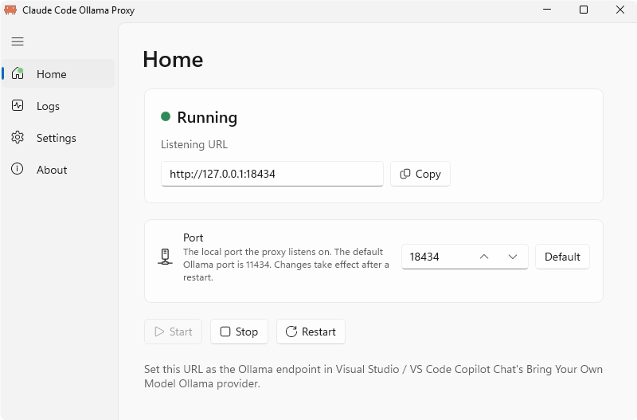
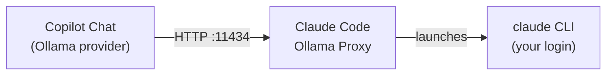
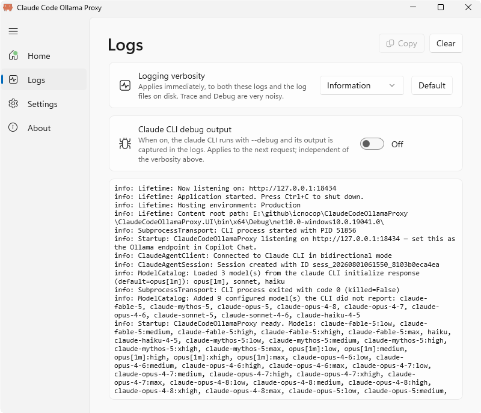
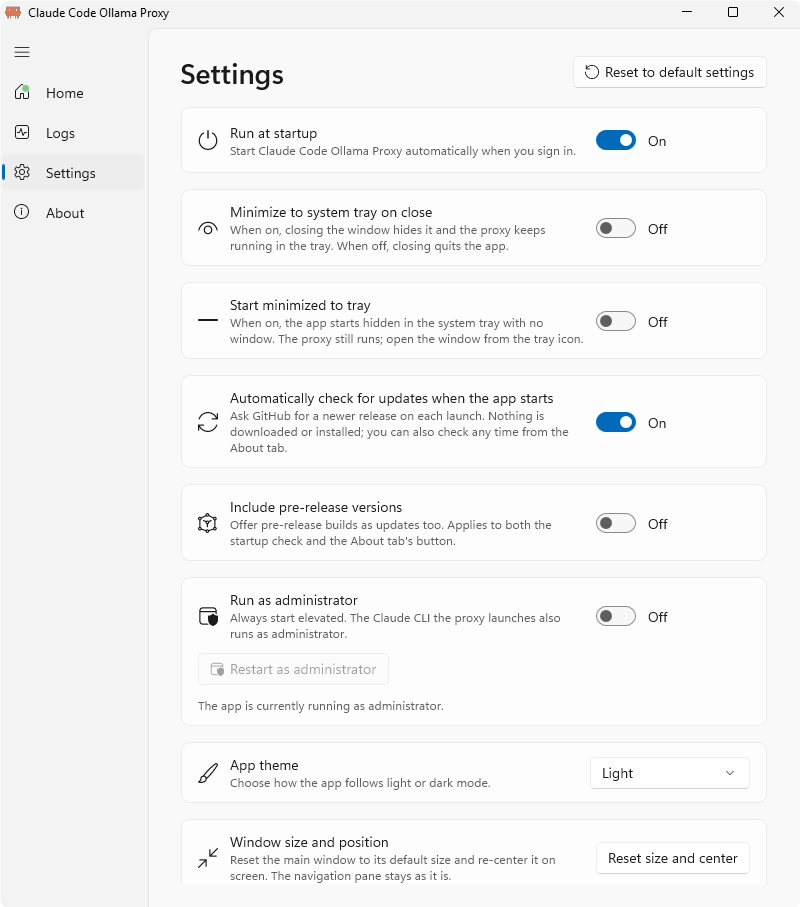
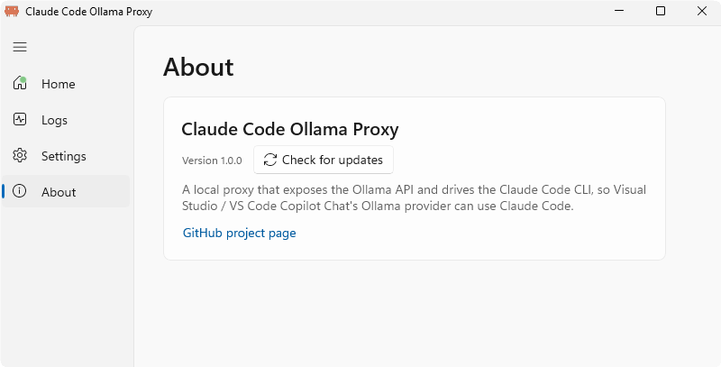

# Claude Code Ollama Proxy

Use **Claude Code** inside Visual Studio / VS Code **GitHub Copilot Chat** — including Copilot's native
diff / Accept-Reject UI — with no extra extension. The app runs a local server that implements the
**Ollama API** and drives your existing **Claude Code CLI** login.

  <picture>
    <source media="(prefers-color-scheme: dark)" srcset="docs/screenshots/home-dark.png">
    
  </picture>

## How it works

## Getting started

1. Install the **Claude Code CLI** and sign in (`claude login`).
2. Run the console or tray app — it serves on `http://127.0.0.1:11434`.
3. In Copilot Chat, add an **Ollama** provider pointed at that URL —
   [Visual Studio setup](docs/visual-studio-setup.md) ·
   [VS Code setup](docs/vscode-setup.md).
4. Pick a Claude model in the model picker and switch to **Agent** mode to let Claude edit files.

Requires **Visual Studio 2022 17.14+** / **Visual Studio 2026**, or **VS Code 1.99+** — the builds
whose Copilot Chat has an Ollama Bring Your Own Model provider.

**Visual Studio only:** **Manage models** is hidden for Copilot Business / Enterprise accounts, so a
GitHub account tied to an Organization may need to be swapped for a personal one — see the
[Visual Studio setup](docs/visual-studio-setup.md) doc.

## Features

**Main window**

- 🟢 **Home** — start / stop / restart the proxy, see live status, copy the listening URL, and set the
  port.
- 📜 **Logs** — watch the proxy's live log output in-app, set the logging verbosity (applied
  immediately, no restart), enable Claude CLI debug output, and select text freely across lines to copy.
- ⚙️ **Settings** — pick a theme (System / Light / Dark), run at startup, run as administrator, choose
  whether closing minimizes to tray, start minimized to the tray, check for updates at startup (and
  whether pre-releases count), and reset the window size or all settings.
- ℹ️ **About** — version info, a **Check for updates** button, and a link to the project page.

**Updates**

- 🔄 **Check for updates** — the About tab compares this build against the project's GitHub releases and
  tells you when a newer one exists, with a link straight to it. Nothing is ever downloaded or installed
  for you. The check also runs at startup by default; turn that off (or opt into pre-releases) in
  **Settings**.
- 🔵 **Visible while minimized** — when an update is found the tray and taskbar icon gain a blue download
  marker (opposite the status dot), the tray tooltip names the new version, and the **About** tab is
  badged. Starting hidden in the tray never pops a dialog at you.

**Models**

- 🧠 **Every current Claude model, at every effort level** — Fable 5, Mythos 5, Opus 5 / 4.8 / 4.7 / 4.6,
  Sonnet 5 / 4.6, and Haiku 4.5 each appear in Copilot's **Bring Your Own Model** picker once per
  supported effort level, alongside the CLI's own family aliases. Pick an exact version instead of
  relying on what `opus` or `sonnet` currently resolves to. The list is sorted by name, then by effort,
  so each model's variants stay together.

**System-tray icon**

- 🎨 **Live status glyph** — the tray (and taskbar / title-bar) icon shows a status dot that changes
  color with the proxy state.
- 💬 **Tooltip** — hover to see the running state and listening URL.
- 🖱️ **Single click** — opens the main window.

**Tray right-click menu**

- 🪟 **Open** — show the main window.
- 📋 **Copy URL** — copy the current listening URL (shown inline in the menu).
- ▶️ **Start** / ⏹️ **Stop** / 🔄 **Restart** — control the proxy without opening the window
  (enabled to match the current state).
- ❌ **Quit** — fully exit the app (closing the window keeps it running in the tray).

**Reliability**

- 🛡️ Fault-tolerant logging and global exception handlers with crash logging keep the app running and
  capture failures for diagnosis.

## Screenshots

### Logs
<picture>
  <source media="(prefers-color-scheme: dark)" srcset="docs/screenshots/logs-dark.png">
  
</picture>

### Settings
<picture>
  <source media="(prefers-color-scheme: dark)" srcset="docs/screenshots/settings-dark.png">
  
</picture>

### About
<picture>
  <source media="(prefers-color-scheme: dark)" srcset="docs/screenshots/about-dark.png">
  
</picture>

## Documentation

- [How it works](docs/how-it-works.md) · [The tool-call bridge](docs/tool-call-bridge.md)
- [Visual Studio setup](docs/visual-studio-setup.md) · [VS Code setup](docs/vscode-setup.md) ·
  [Effort levels](docs/effort-levels.md)
- [Configuration](docs/configuration.md) · [Logging](docs/logging.md) · [Image input](docs/image-input.md)
- [Troubleshooting](docs/troubleshooting.md) · [Limitations](docs/limitations.md) · [References](docs/references.md)
- [Changelog](CHANGELOG.md) — notable changes per release
- [Development](DEVELOPMENT.md) — build, run, and test from source

## License

See [LICENSE.txt](LICENSE.txt).
